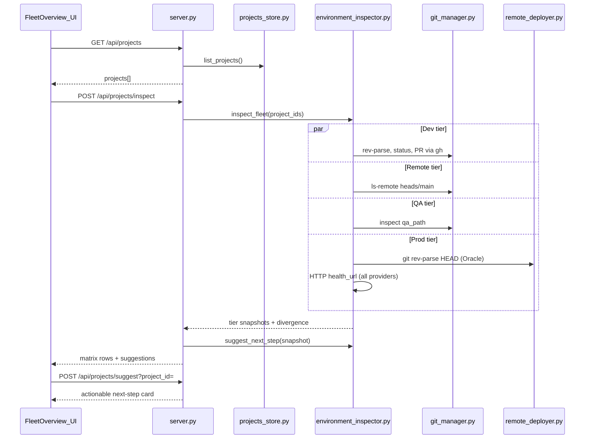

# Project Fleet Matrix & Environment Topology

## Architecture



## 1. Persistent Project Registry — [`projects_store.py`](projects_store.py)

**Storage:** `~/.shipmate/projects.json`

```json
{
  "projects": [
    {
      "project_id": "appforge",
      "name": "AppForge",
      "stack": "FastAPI / Next.js",
      "remote_url": "https://github.com/karthikwin-hub/appforge.git",
      "dev_path": "C:\\Cursor\\Projects\\appforge",
      "qa_path": "~/.shipmate/repos/karthikwin-hub/appforge",
      "prod_ssh_host": "140.238.12.4",
      "prod_remote_path": "/var/www/appforge",
      "health_url": "https://api.example.com/health",
      "provider": "oracle_vm",
      "created_at": "2026-08-19T...",
      "updated_at": "2026-08-19T..."
    }
  ]
}
```

**Functions:**
- `load_projects()` / `save_projects()`
- `list_projects()` / `get_project(project_id)`
- `create_project(data)` — auto-generate `project_id` slug from remote URL or name if omitted; validate uniqueness
- `update_project(project_id, data)` / `delete_project(project_id)`
- **`auto_populate_from_path(path)`** — detect stack via [`CommandRunner.detect_stack()`](runner.py), origin via [`GitManager.get_origin_url()`](git_manager.py), prod fields from [`.shipmate/deploy.yaml`](project_config.py) via `get_effective_oracle_config()` / `get_deploy_section()`, default `qa_path` via [`cache_path_for_remote()`](repo_resolver.py)
- **`import_from_registered_paths()`** — one-time helper to seed from [`shipmate_user_config.get_registered_paths()`](shipmate_user_config.py); on save with `dev_path`, also call `register_local_path()` to keep repo sync discovery working

**Coexistence with `config.json`:** `projects.json` is the fleet source of truth; `config.json` registered paths remain for local-vs-cache sync. Saving a project with `dev_path` updates both.

---

## 2. Cross-Environment Inspector — [`environment_inspector.py`](environment_inspector.py)

Async module using `asyncio.gather` + `asyncio.to_thread()` for blocking git/subprocess/SSH/HTTP calls.

### Tier inspectors (per project)

| Tier | Source | Data collected |
|------|--------|----------------|
| **Dev** | `dev_path` (if exists on host) | branch, `git rev-parse HEAD`, subject line, [`get_working_tree_summary()`](git_manager.py), sync status via [`get_sync_status()`](git_manager.py) |
| **Remote** | `remote_url` | default branch via `git ls-remote --symref`, HEAD commit on active PR branch (from Dev `gh pr view` if available, else main), PR `{number, state, title, reviewDecision}`, optional CI label placeholder (`gh` unavailable → `"unknown"`) |
| **QA** | `qa_path` (fallback: namespaced cache path) | branch, commit, delta vs remote PR/main via `git rev-list --left-right --count` after fetch; label `"Up to date"` / `"N commits behind"` / `"Unreachable"` if path missing on current machine |
| **Prod** | Provider-aware (user choice) | **Oracle VM:** lightweight SSH via [`RemoteDeployer.execute_ssh_cmd("git rev-parse HEAD")`](remote_deployer.py) + optional `git describe --tags`; **Vercel/Firebase:** no SSH — show provider label + [`health_url`](project_config.py) HTTP probe only; unreachable host → amber pill with reason |

### New GitManager helpers (small additions to [`git_manager.py`](git_manager.py))

- `get_head_commit()` → `{hash, short, message}`
- `get_remote_head(url, branch)` → commit via `git ls-remote`
- `count_commits_ahead_behind(local_path, remote_ref)` → `{ahead, behind}` for divergence math

### Normalized snapshot schema

```python
@dataclass
class TierSnapshot:
    reachable: bool
    status: str          # clean | dirty | synced | behind | ahead | unreachable | ok | timeout
    branch: str | None
    commit: str | None
    commit_short: str | None
    message: str | None
    extra: dict          # pr, delta, health, provider, tag, etc.

@dataclass
class ProjectInspection:
    project_id: str
    tiers: dict[str, TierSnapshot]   # dev, remote, qa, prod
    divergence: dict[str, str]       # dev_vs_remote, qa_vs_remote, prod_vs_main
    inspected_at: str
```

**Public async API:**
- `inspect_project(project: dict) -> ProjectInspection`
- `inspect_fleet(projects: list[dict]) -> list[ProjectInspection]` — parallel with per-project timeout (e.g. 15s)
- `suggest_next_step(inspection: ProjectInspection, qa_checklist: dict | None) -> dict` — see below

**Caching:** In-memory TTL cache (60s) keyed by `project_id` to avoid hammering SSH on repeated UI refreshes; "Refresh All Sync" bypasses cache.

---

## 3. Workflow Suggestions Engine

Logic in `suggest_next_step()` inside [`environment_inspector.py`](environment_inspector.py), reusing existing signals:

| Condition | Suggestion card |
|-----------|-----------------|
| Dev dirty or Dev commit != Remote tracking branch (ahead > 0) | **Push changes and open PR** — CTA: switch to project pipeline Dev stage |
| Open PR exists, QA commit behind Remote PR branch | **Pull latest PR branch into QA** — CTA: QA Pull & Setup |
| PR merged / QA synced with main, QA checklist incomplete | **Finish QA checklist (X/Y complete)** — pull manual checklist from [`ChecklistEngine`](checklist_engine.py) via `dev_path` or `qa_path` |
| QA checklist complete + main synced, Prod commit != Remote main | **Deploy main to Oracle VM** (or provider label) — CTA: Prod Deploy |
| Prod behind main by N commits | **Production is N commits behind main — Ready for Deploy** |

Also incorporate [`audit_analytics.suggest_current_stage()`](audit_analytics.py) as secondary hint in the card footer.

Return shape for `/api/projects/suggest`:

```json
{
  "title": "QA Manual Checklist is 3/4 complete",
  "detail": "Finish smoke testing to unlock Approve & Merge",
  "action": "qa_checklist",
  "cta_label": "Open QA Stage",
  "priority": "medium",
  "target_repo": "C:\\Cursor\\Projects\\appforge"
}
```

---

## 4. Backend API — [`server.py`](server.py) + [`pipeline_service.py`](pipeline_service.py)

Thin routes delegating to store + inspector.

| Method | Route | Body / Params | Response |
|--------|-------|---------------|----------|
| GET | `/api/projects` | — | `{projects: [...]}` |
| POST | `/api/projects` | project fields | created project |
| PUT | `/api/projects/{project_id}` | partial update | updated project |
| DELETE | `/api/projects/{project_id}` | — | `{success}` |
| POST | `/api/projects/auto-populate` | `{path}` | draft project object (not saved) |
| POST | `/api/projects/import-registered` | — | imported count |
| POST | `/api/projects/inspect` | `{project_ids?: string[]}` | `{inspections: [...], suggestions: [...]}` |
| GET | `/api/projects/suggest` | `?project_id=` | single suggestion card (+ optional cached inspection) |

**Refresh All Sync:** Frontend calls `POST /api/projects/inspect` with no IDs (inspect all). For fleets >5 projects, optionally return a `job_id` and stream progress via existing WebSocket pattern in [`job_manager.py`](job_manager.py) — implement job streaming only if inspect exceeds ~10s in testing; start with synchronous async endpoint.

Add Pydantic models: `ProjectBody`, `ProjectUpdateBody`, `ProjectInspectBody`, `AutoPopulateBody`.

---

## 5. Frontend — Fleet Overview Tab

### Navigation ([`static/js/app.js`](static/js/app.js), [`static/index.html`](static/index.html))

- Add `activeView: 'fleet'` and header nav icon (grid/fleet icon) alongside Activity
- New state: `fleetProjects`, `fleetInspections`, `fleetLoading`, `projectForm`, `editingProjectId`
- **`openFleet()`** — load projects + run inspect
- **`refreshFleet()`** — POST inspect all (bypass cache)
- **`openProject(project)`** — set `repoInput` / `repo`, sync if needed, switch to `activeView='pipeline'`

### Fleet Matrix layout (matches mockup)

Each project card:
- Header: name, stack pill, remote URL
- 4-column grid: Dev | Remote | QA | Prod
- Color-coded pills: green (clean/synced/200 OK), amber (dirty/behind/manual test), red (unreachable/timeout)
- Commit short hash + message truncated
- Suggestion banner below card with CTA button

### Project Management Modal

- Form fields matching registry schema
- **Auto-populate from current repo** — uses active `context.repo` or input path → `POST /api/projects/auto-populate`
- **Auto-populate from Git remote** — parses `repoInput` URL
- **Import registered paths** — one-click seed
- Add / Edit / Delete with validation feedback

### CSS ([`static/css/shipmate.css`](static/css/shipmate.css))

- `.fleet-card`, `.fleet-tier-col`, `.fleet-tier-grid` (4-col responsive → stack on mobile)
- Reuse existing `.pill-*`, `.panel`, `.btn-primary` patterns

---

## 6. Tests

| File | Coverage |
|------|----------|
| [`tests/unit/test_projects_store.py`](tests/unit/test_projects_store.py) | CRUD, slug generation, auto-populate mock |
| [`tests/unit/test_environment_inspector.py`](tests/unit/test_environment_inspector.py) | suggestion rules, divergence math, unreachable tiers |
| [`tests/integration/test_api_projects.py`](tests/integration/test_api_projects.py) | REST CRUD, inspect, suggest endpoints |

Mock `RemoteDeployer.execute_ssh_cmd`, `subprocess.run` for git/gh, and use existing `tmp_git_repo` fixture.

---

## 7. Documentation

Update [`README.md`](README.md) with Fleet Overview section: registry location, tier meanings, auto-populate workflow, provider-aware prod inspection note.

---

## Key design decisions

1. **`projects.json` is fleet-canonical**; `config.json` stays for sync discovery — linked on save.
2. **QA tier inspects local `qa_path` only** (no SSH to Linux QA host); mark unreachable when path absent on current machine.
3. **Prod tier is provider-aware** (per your choice): Oracle VM = SSH commit + health; Vercel/Firebase = health URL + provider badge, SSH column shows "N/A".
4. **Inspection is async** at the Python layer; API endpoints are `async def` with parallel tier probes.
5. **No auto-destructive actions** from Fleet view — suggestions link into existing pipeline stages only.

## Files to create/modify

| File | Action |
|------|--------|
| `projects_store.py` | **Create** |
| `environment_inspector.py` | **Create** |
| `git_manager.py` | Extend commit/divergence helpers |
| `server.py` | Add `/api/projects/*` routes |
| `pipeline_service.py` | Optional thin wrappers for inspect/suggest |
| `static/js/app.js` | Fleet view + project modal |
| `static/index.html` | Fleet tab + modal markup |
| `static/css/shipmate.css` | Fleet grid styles |
| `README.md` | Fleet docs |
| Tests (3 new files) | Unit + integration |
